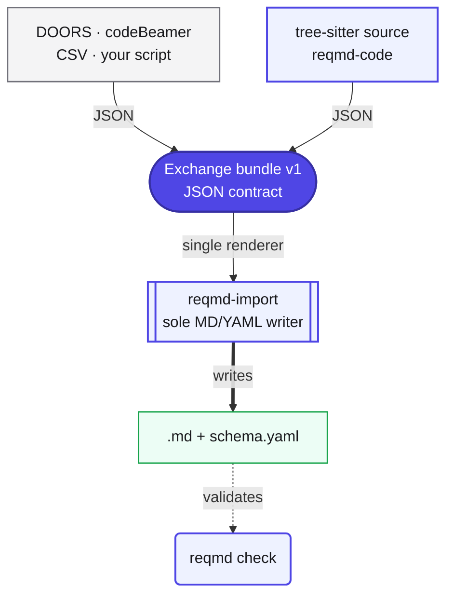

The exchange format is how requirement data enters reqmd from anywhere else —
a DOORS or codeBeamer export, a database query, a source-code extractor, a
spreadsheet converter. One producer writes a JSON bundle; `reqmd-import` renders
it into reqmd documents (`schema.yaml` plus Markdown).

Nothing in the format depends on reqmd. There is no reqmd-only required field,
no id scheme to know about, and no YAML to get right. If you can write JSON and
read the two tables below, you can produce a bundle.

Two directions feed the same contract:



The built-in producer is [reqmd-code](/import/reqmd-code/); the renderer is
[reqmd-import](/import/reqmd-import/). Load the [JSON Schema](/exchange/v1/schema.json)
into your producer's tests and validate a bundle before you ever run the
renderer.

**v1 is unstable.** The format is still in alpha and may change without a
version bump until the first tagged release. Every breaking change afterwards
moves the `$schema` URL to a new version.

```sh
reqmd-code ./src                     | reqmd-import - -o spec/code   # a built-in producer
python my_alm_export.py -o bundle.json                            # your own producer
reqmd-import bundle.json -o spec/alm --validate-only              # check a bundle, write nothing
reqmd-import bundle.json -o spec/alm                              # render it
```

## 1. Shape

```text
bundle    { "$schema", documents[] }
document  { key, title, body?, items[], properties?, required?, x-reqmd{}? }
item      { kind, key?, title?, body?, fields?, status?, links?, refs?, children[]? }
```

Everything below is the contract. The machine-readable form is
[`/exchange/v1/schema.json`](/exchange/v1/schema.json) — load it into your
producer's tests and validate before you ever call `reqmd-import`.

## 2. Bundle

| Field | Type | Required | Meaning |
| --- | --- | --- | --- |
| `$schema` | string | yes | Exactly `https://reqmd.dev/exchange/v1/schema.json`. Any other value is rejected. |
| `documents` | array | yes | One or more documents, rendered in array order. An empty array is an error. |

Unknown fields anywhere in the bundle are rejected. A producer typo fails
loudly instead of silently dropping data.

## 3. Document

| Field | Type | Required | Meaning |
| --- | --- | --- | --- |
| `key` | string | yes | Stable document identity, unique across the bundle, no `/` and no whitespace. Qualifies cross-document links. |
| `title` | string | yes | The document title (a single line). |
| `body` | string | no | Preamble prose rendered under the title, before the first item. |
| `items` | array | no | The document's content, in document order. |
| `properties` | object | no | JSON Schema property definitions for requirement fields. |
| `required` | array | no | Field names every requirement in this document must carry. |
| `x-reqmd` | object | no | Renderer configuration (see §7). Omit it entirely if you are not reqmd-aware. |

A document with no `items` produces only a `schema.yaml` — that is a legitimate
way to declare a tree level or a shared id-prefix.

## 4. Item

| Field | Type | Required | Meaning |
| --- | --- | --- | --- |
| `kind` | `"requirement"` \| `"section"` | yes | See below. |
| `key` | string | requirements | Stable identity, unique within the document, no whitespace. |
| `title` | string | no | Heading text (a single line). An untitled section renders as plain prose with no heading. |
| `body` | string | no | Markdown prose. **Must not contain headings** (see §6). |
| `fields` | object | no | Attributes of the generated reqmd block. Requirements only. |
| `status` | string | no | Free-form status; the renderer maps it (see §8). |
| `links` | array of strings | no | Keys of other items. Must resolve. |
| `refs` | array of strings | no | External requirement IDs, passed through verbatim. |
| `children` | array | no | Nested items, in document order. |

### `kind`

- **`requirement`** — content. Renders as a heading with a `reqmd` block, takes
  part in validation, tracing, coverage and every export. Requires `key`.
- **`section`** — structure. Renders as a heading with prose and children, and
  gets no `reqmd` block. Never validated, never traced to, never counted as
  coverage. Rejects `fields` and `status`.

That is the whole difference. `kind` answers exactly one question — *does this
item get a reqmd block* — and nothing else. Whether a section contains children
or is a leaf is derived, never declared.

An empty section is meaningful (a placeholder chapter) and is rendered as-is.

### Nesting

`children` replaces a parent pointer entirely. Nesting therefore cannot contain
a cycle, cannot reference a missing parent, and cannot be out of order; there is
no rule to learn. Item order is document order.

## 5. Identity, `links` and `refs`

`key` is the producer's own stable ID for an item — a DOORS object number, a
codeBeamer item ID, a database primary key. Keys are unique **within a
document**, not across the bundle.

- `links` entries name other items: a bare `key` refers to the same document,
  `doc-key/key` refers to an item in another document of the same bundle.
  Every entry must resolve to a requirement — linking to a section is an error.
- `refs` entries are requirement IDs owned elsewhere, written out verbatim
  (`SYS-BRAKE-001`). They are never resolved or validated by the importer; if
  the target is missing from your reqmd tree, `reqmd check` reports it.

Use `links` for "the other end of this link is in this bundle". Use `refs` for
"the other end lives in a document I am not importing". The renderer stamps
`links` into full requirement IDs; `refs` pass through untouched.

## 6. `body`

`body` is Markdown and is rendered as written. It **must not contain headings**
— not `# …` and not a setext underline (`Text` followed by `---` or `===`).
Structure belongs in `kind: "section"` items, where it can be nested and
navigated.

The renderer does not verify this; it is a producer obligation. Markdown
examples in a body must be fenced so they are not parsed as headings:

`````text
````markdown
## This is an example, not a heading
````
`````

## 7. `x-reqmd` — renderer configuration

Everything reqmd-specific lives here, so a producer that only reads the neutral
fields never needs to look at it.

| Field | Meaning |
| --- | --- |
| `id-prefix` | Prepended to every requirement key to form the reqmd ID. Without it, the ID is the bare key. |
| `level` | The V-model layer this document belongs to. |
| `document-id` | The document's identity inside the reqmd tree; also the qualifier reqmd uses in cross-document trace refs. |
| `upstream` | `{ level, sources[] }` — where upstream requirements are expected from. |
| `requires-trace-from` | Document default for the coverage expectation applied to every requirement. |
| `external` | Marks the document as a mirror of content authored elsewhere. |
| `file` | Output Markdown filename inside the document directory (default `requirements.md`). |

When `document-id` differs from `key`, `key` stays the bundle-internal
qualifier and `document-id` is what appears in emitted trace references. A
document with neither emits dir-qualified references.

## 8. `status`

`status` is a free-form string in the bundle: a source system's own vocabulary
(`Approved`, `In Review`, `Draft`) is fine. `reqmd-import` maps it:

- with `--status-map "Approved=approved,In Review=review"` the mapped value is used;
- an unmapped value falls back to reqmd's default (`approved`) and the original
  is preserved as `x-reqmd.source-status` on the requirement, with a warning on
  stderr;
- mapped values are added to the document's `x-reqmd.additional-status-values`,
  so the rendered tree still validates.

Omit `status` entirely if the source has none.

## 9. Rules the renderer enforces

All of these are hard errors, reported together (up to 20 at a time) and
addressed by item path — `brakes/Brakes/17`, or the title path when a section
has no key. The renderer never normalizes, reorders or drops anything.

- `$schema` is not exactly the v1 URL
- `documents` is empty, or two documents share a `key`
- a document `key` contains `/` or whitespace, or a `title` contains a line break
- `kind` is missing or unknown
- a requirement has no `key`; two items in one document share a `key`
- a `section` carries `fields` or `status`
- a `links` entry does not resolve, or resolves to a section
- `fields` names an attribute the document's `properties` does not declare
- a `required` field has no value on some requirement in the document
- a `fields` value is a nested object or list, or an attribute name contains a
  character reqmd's attr scanner cannot read back
- nesting exceeds the decode depth limit (32)
- an item nestles deeper than six heading levels (`######`); flatten in the producer

## 10. Two examples

### A source tool with sections (DOORS, codeBeamer)

```json
{
  "$schema": "https://reqmd.dev/exchange/v1/schema.json",
  "documents": [
    {
      "key": "brakes",
      "title": "Brakes Module",
      "properties": {
        "priority": { "type": "string", "enum": ["High", "Low"] }
      },
      "required": ["priority"],
      "x-reqmd": { "id-prefix": "DOORS-", "level": "stakeholder-requirements", "external": true },
      "items": [
        {
          "kind": "section",
          "title": "Hydraulics",
          "body": "The hydraulic circuit.",
          "children": [
            {
              "kind": "requirement",
              "key": "17",
              "title": "Brake request",
              "body": "The vehicle shall decelerate on demand.",
              "status": "Approved",
              "fields": { "priority": "High" },
              "refs": ["SYS-BRAKE-001"],
              "links": ["42"]
            },
            {
              "kind": "requirement",
              "key": "42",
              "title": "Brake pressure",
              "fields": { "priority": "High" }
            }
          ]
        }
      ]
    }
  ]
}
```

Rendered: `DOORS-17` and `DOORS-42` under a `Hydraulics` section, with a trace
to the external `SYS-BRAKE-001` and to sibling `DOORS-42`.

### A code extractor (flat requirements, methods nested under their type)

```json
{
  "$schema": "https://reqmd.dev/exchange/v1/schema.json",
  "documents": [
    {
      "key": "parser",
      "title": "Package: parser",
      "x-reqmd": { "id-prefix": "IMP-parser-", "level": "software-requirements" },
      "items": [
        {
          "kind": "requirement",
          "key": "Parser-1a2b",
          "title": "Parser",
          "body": "Parses a document.",
          "children": [
            { "kind": "requirement", "key": "Parse-3c4d", "title": "Parse" }
          ]
        }
      ]
    }
  ]
}
```

## 11. What this format does not do

- **No round-trip export yet.** `reqmd` cannot emit a bundle from an existing
  tree. The format is designed to carry everything a round trip would need
  (nesting, stable keys, no normalization), but the export direction is future
  work.
- **No section identity.** Sections have no permanent ID, so a link cannot point
  at one and there is nothing to bookmark across re-imports.
- **No field inheritance.** Every requirement repeats its own attributes;
  nothing is inherited from an enclosing section.
- **No typed links.** `links` carry no link kind (derives / satisfies /
  verifies). Map them to fields, or wait for a later version.
