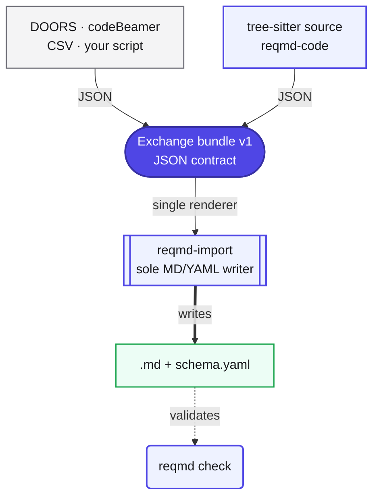
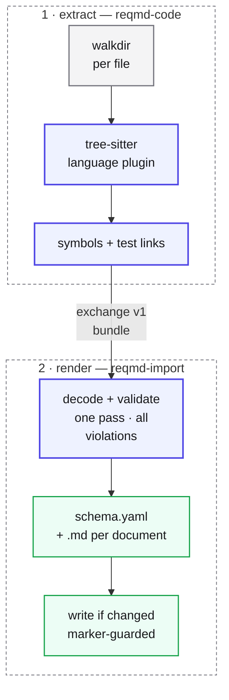

Requirements rarely start (or end) inside reqmd. Two halves of the same
problem:

- **Code** — the functions, types, and methods that *implement* your spec need
  proxy requirements so traces resolve end to end.
- **ALM tools** — the DOORS or codeBeamer items that product managers review
  need to land in the spec tree as generated, reviewed-as-diffs documents.

Both are handled the same way: a small producer emits one JSON bundle in the
[exchange format](/exchange/v1/), and a single renderer (`reqmd-import`) writes
the actual reqmd documents. Nobody but the renderer writes `attr` blocks or
`schema.yaml`.



Why one renderer: a second Markdown writer in Python (or Java, or DXL) would
drift from the quoting, heading, and schema rules. The JSON format is the
stable contract; the renderer is the only code that knows the file syntax.

## The two tools

- **[reqmd-code](/import/reqmd-code/)** walks C, C++, Go, Python, and Rust
  source with tree-sitter and emits every symbol as a proxy requirement. It
  also links a unit test to the symbol it tests — explicitly with
  `reqmd:trace`, or by convention with `--link-tests`.
- **[reqmd-import](/import/reqmd-import/)** renders any exchange bundle (from
  `reqmd-code`, the Python `reqmd_io` package, a DOORS/codeBeamer script, or
  your own importer) into `schema.yaml` plus Markdown, idempotently.
- **[Exchange format v1](/exchange/v1/)** is the neutral JSON contract both
  sides speak; the machine-readable [schema.json](/exchange/v1/schema.json)
  ships with it.

## The trace gap

Plain Markdown traceability has a directional problem. A software requirement
can `trace: [system-requirements/SYS-001]` and reqmd validates that SYS-001
exists upstream. But the *implementation* — the function that actually
implements the requirement — has no native concept of a reqmd ID. Without
help you maintain a mapping table by hand, use an IDE plugin, or give up and
let the spec stop at the test layer.

`reqmd-code` produces that mapping. It emits the symbols as an exchange
bundle; `reqmd-import` renders the bundle, and the IDs then exist in the spec
tree. The agent and the human can grep them, link them, and CI enforces that
they still resolve. When a function is renamed or moved, the next run updates
the file — the ID is a hash of `(package, symbol)`, not a position, so the spec
tree still points at the same requirement.

## Where it fits in the workflow

```sh
# 1. Author the spec by hand
reqmd init my-feature/
$EDITOR my-feature/stakeholder/goals.md
$EDITOR my-feature/system/features.md
reqmd check my-feature/                       # pass

# 2. Import the upstream requirements from the ALM (optional)
python my_doors_import.py -o doors.json
reqmd-import doors.json -o my-feature/00-doors/

# 3. Write the code, then extract proxies and re-validate
reqmd-code --link-tests ./src | reqmd-import - -o my-feature/03-software/imported
reqmd check my-feature/                       # still pass

# 4. CI runs the same check on every PR
#    - run: reqmd check spec/
```

The agent — and the human — can then answer questions like:

- *What functions implement SYS-001?* — `grep -r "SYS-001" spec/03-software/imported/`
- *What spec IDs does `foo/bar.go` correspond to?* — `reqmd ls spec/ | grep "bar.go"`
- *Which code is untested?* — load CTRF results with
  `reqmd check spec/ --results ctrf.json`; the `missing-verdict` check fires on
  measures with no test.

## What it doesn't do

- **Guess traceability.** Generated items start with `trace: []` (or a link
  from an explicit marker / an opt-in convention match). Nothing is invented
  silently.
- **Refresh on every commit.** You re-run the producer when you want new
  output. Incremental sync is a per-tool concern that would add drift for a
  workflow that runs once per PR or release.
- **Read binary artefacts.** `reqmd-code` reads source, not compiled binaries
  or runtime behaviour; add a runtime instrumentation step if you need that.
- **Sync content back into the ALM.** The spec tree is the review surface; the
  ALM stays the system of record for its own items.

## Architecture



Each stage is independently testable. The renderer's idempotency guarantee
(byte-identical output for unchanged input, hand-authored files untouched) is
what makes both import paths safe to re-run in CI. The tree-sitter grammars
are loaded once at startup and per-file parsing is dispatched to a worker pool
sized to `runtime.NumCPU()`.

## See also

- [Quickstart](/quickstart/) — including step 15, a custom CSV importer.
- [Use cases](/use-cases/) — where the importers sit in the engineering workflow.
- [Compare](/compare/) — how reqmd compares to other tools.
- Sources: [`reqmd-code`](https://github.com/dVoo/reqmd/tree/main/reqmd-code),
  [`reqmd-import`](https://github.com/dVoo/reqmd/tree/main/reqmd-import),
  [`python/`](https://github.com/dVoo/reqmd/tree/main/python).
