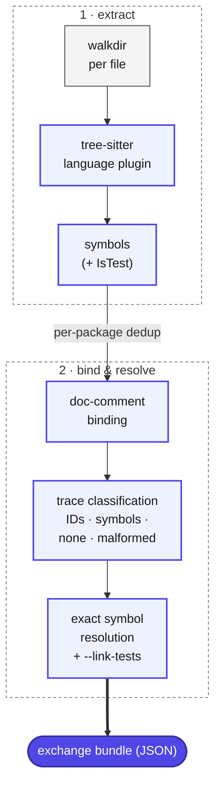

`reqmd-code` walks your source code, parses each file with a tree-sitter
grammar, and emits every symbol as a proxy requirement in the
[exchange format](/exchange/v1/). The source path is recorded as provenance,
the symbol kind is preserved, and the doc comment becomes child section items
under the symbol. Symbols are grouped into one `## <path>` section per source
file, and methods nest under their parent type via `children`.

It is the built-in producer for the pipeline described on the
[Code & import](/import/) page; `reqmd-import` renders its bundle.

```sh
go build -o reqmd-code ./reqmd-code/cmd/reqmd-code

reqmd-code ./internal                        # bundle to stdout
reqmd-code ./internal -o imported.json       # bundle to a file
reqmd-code --link-tests ./internal \
  | reqmd-import - -o spec/03-software/imported
```

## Output anatomy

Requirements are rendered one `.md` file per package (`package.md`), under an
`IMP-<package>-` ID prefix. Given `internal/cli/check_test.go`:

````markdown
# Package: cli

<!-- reqmd: generated -->

## internal/cli/check_test.go
### IMP-cli-BenchmarkRunValidationPipeline-80e6286: BenchmarkRunValidationPipeline
```attr
status: approved
x-reqmd.imported: true
x-reqmd.source-file: internal/cli/check_test.go
x-reqmd.source-line: 19
x-reqmd.symbol-kind: function
trace: []
```

BenchmarkRunValidationPipeline measures the cost of the full validation
pipeline against the spec/ fixture.
````

The ID format is `IMP-<package>-<symbol>-<7charhash>`. The hash is computed
over `(package, symbol)` so IDs survive line-number shifts — a refactor that
moves code around does not invalidate the trace. Methods get a stable
`<Symbol>-<hash>` key that includes the receiver in the hash, so two types with
a same-named method never collide.

## Linking a unit test to the code it tests

A symbol's doc comment can carry `reqmd:trace` directives. They are read from
the doc comment that binds to the symbol (the comment immediately above it, plus
a Python docstring), and they support three target kinds in one line or across
several lines:

```go
// reqmd:trace Parse
// reqmd:trace Parser.Parse
// reqmd:trace clang/Parse
// reqmd:trace SW-PAR-001~2
// reqmd:trace none
func TestParseFromDisk(t *testing.T) {}
```

The forms are: a bare `Name` or `Type.Method` symbol in the same package,
`Parser::Parse` for `Parser.Parse`, `pkg/Name` (or `pkg/Type.Method`) to
qualify the package, a requirement ID to pass a ref through to `trace:`, and
`none` to opt out of convention linking. One target per line, or a
comma-separated list. An inline `// comment` after a target is part of the
target and is rejected as malformed.

**Requirement IDs** (tokens shaped like `SW-PAR-001`, `system/REQ-1~2`, or a
generated `IMP-clang-Parse-479c6b0`) land in the generated `trace:` block
verbatim and are validated by `reqmd check` like any authored reference.

**Symbol references** (`Parse`, `Type.Method`, `Parser::Parse`, `pkg/Parse`,
`pkg/Type.Method`) are resolved exactly against the symbols found in this run —
case-sensitive, no prefix matching, no fuzzy fallback. The search order is the
same package, then the base package of a test package (`foo_test` → `foo`,
`test_foo` → `foo`), then a globally unique match; `pkg/...` searches only that
package. A resolved symbol becomes a real trace edge to the generated
requirement (cross-document when the symbol lives in another package).

**Resolution failures are hard errors.** An unresolved, ambiguous, or malformed
directive prints a batched, sorted diagnostic (capped at 20) and the run exits
non-zero **before writing anything**: stdout stays empty and an `-o` file is
never created or truncated. A renamed symbol breaks the run until the comment is
fixed — no silent gap.

```text
invalid reqmd:trace references:
  - a_test.go:22 (TestParse): unresolved symbol trace "Parse"
  - b_test.go:8 (TestFoo): ambiguous symbol trace "Foo" (matches: alpha/Foo, beta/Foo)
  - c_test.cpp:30 (test_bar): invalid reqmd:trace marker "foo bar" (expected a symbol or a requirement ID)
```

`none` is reserved: it disables the convention linking below for that item and
never suppresses explicit targets. Use `pkg/none` if a package really contains a
symbol named `none`.

### Convention linking (`--link-tests`)

`--link-tests` (off by default) adds links by name for tests that have no
explicit directive:

| Test name | Symbol | Rule |
|---|---|---|
| `TestParse` | `Parse` | Go CamelCase, same package |
| `TestParseFromDisk` | `ParseFromDisk`, else `Parse` | longest name at a CamelCase boundary |
| `TestCleanComment` | `cleanComment` | unexported Go function |
| `TestGraph_CheckResults` | `Graph` method `CheckResults` | receiver + `_` + method |
| `TestParseSample` | `CLanguage` method `Parse` | bare method name when unambiguous; a same-named function wins |
| `test_parse` | `parse` | Python/Rust/C/C++ snake case |

- Only test functions/methods participate, detected by per-language test-file
  conventions (`*_test.go`, `test_*.py`/`*_test.py`, `tests/*.rs`/`*_test.rs`,
  `test_*`/`*_test` C/C++) or an AST marker (`#[test]`, including
  `#[tokio::test]`).
- Targets are production functions, methods, and types. Constants, variables,
  and anything in a test file are never targets.
- Lookup is scoped to the same package and its base package; it never reaches
  into an unrelated package. A tie (two symbols matching at the same length and
  rank) prints a `warn:` line naming the candidates and links nothing — the run
  still succeeds. A real function or type outranks a bare method name.
- Any explicit `reqmd:trace` directive on the item (an ID, a symbol, or `none`)
  suppresses convention linking for that item.

Known limits: a test that names a method without its receiver links to the
bare method name only when it is unambiguous; two types with the same method
name tie with a warning, so write `TestCLanguage_Parse` or an explicit
`reqmd:trace CLanguage.Parse`. A Rust `#[test] fn parse_works()` without a
`test_` prefix has no stem and is not linked. C/C++ test-framework macros (gtest
`TEST`, Catch2 `TEST_CASE`) are not functions in the AST, so only plain `test_*`
functions can link.

## Options

| Flag | Meaning |
|---|---|
| `-o <file>` | Write the JSON bundle to a file instead of stdout (`-` = stdout). |
| `--lang <name>` | Restrict extraction to one language (`go`, `python`, `rust`, `c`, `cpp`). |
| `--id-prefix <prefix>` | Prefix for generated requirement IDs (default `IMP-`). |
| `--heuristic-traces` | Also mine bare requirement IDs from prose into `x-reqmd.heuristic-trace`; these are untrusted and do not satisfy coverage. |
| `--link-tests` | Link unit tests to the symbols their names refer to (see above). Explicit `reqmd:trace` wins. |

## Languages

| Language | Tree-sitter grammar | Notes |
|---|---|---|
| **Go** | `tree-sitter-go` | Functions, methods, types, constants, variables. Package comes from the `package` clause, so internal tests share the document and `package foo_test` becomes its own document. |
| **Python** | `tree-sitter-python` | Functions, classes, methods, constants. Package falls back to the module (file) name; a package `__init__.py` uses its directory name (`reqmd_io`). |
| **C** | `tree-sitter-c` | Functions, struct/enum/union types, typedefs, global variables, `#define` macros. Prototypes and function-local declarations are skipped. |
| **C++** | `tree-sitter-cpp` | Functions, class/struct member functions (inline and declared), types, `using` aliases, typedefs, globals, macros. Method receivers carry the enclosing class; out-of-line `Class::method` definitions and namespaces are not captured. |
| **Rust** | `tree-sitter-rust` | Functions, `impl`/`trait` methods, struct/enum/trait/union types, type aliases, constants, statics. Inline `#[test]` functions are marked as tests. |

To add a language: implement the `lang.Language` interface in a new package
under `reqmd-code/internal/lang/<lang>/` and self-register it via
`lang.Register(&impl{})` in an `init()` block. The blank import in
`cmd/reqmd-code/main.go` pulls all plugins into the binary. Test-file
conventions live in one place (`lang.IsTestFile`).

## What it doesn't do

- **Invent trace links.** Explicit targets must resolve; conventions are
  opt-in and only fill the gap when no directive is present.
- **Read binaries or runtime behaviour.** It reads source. Add a runtime
  instrumentation step for behavioural evidence.
- **Sync back to an ALM.** It produces requirement proxies, not a two-way
  integration.
- **Rewrite the spec into Markdown.** Rendering is `reqmd-import`'s job alone.

## Architecture



Per-package deduplication happens before the symbol index is built, so
build-tag twins (`graph.go` / `graph_stub.go`) count once and can never look
ambiguous. Parsing is dispatched to a worker pool sized to `runtime.NumCPU()`;
output order is stable and byte-deterministic.

## See also

- [reqmd-import](/import/reqmd-import/) — the renderer.
- [Exchange format v1](/exchange/v1/) — the bundle contract.
- [Quickstart 15](/quickstart/15-custom-importers/) — a custom producer.
- [Source](https://github.com/dVoo/reqmd/tree/main/reqmd-code).
