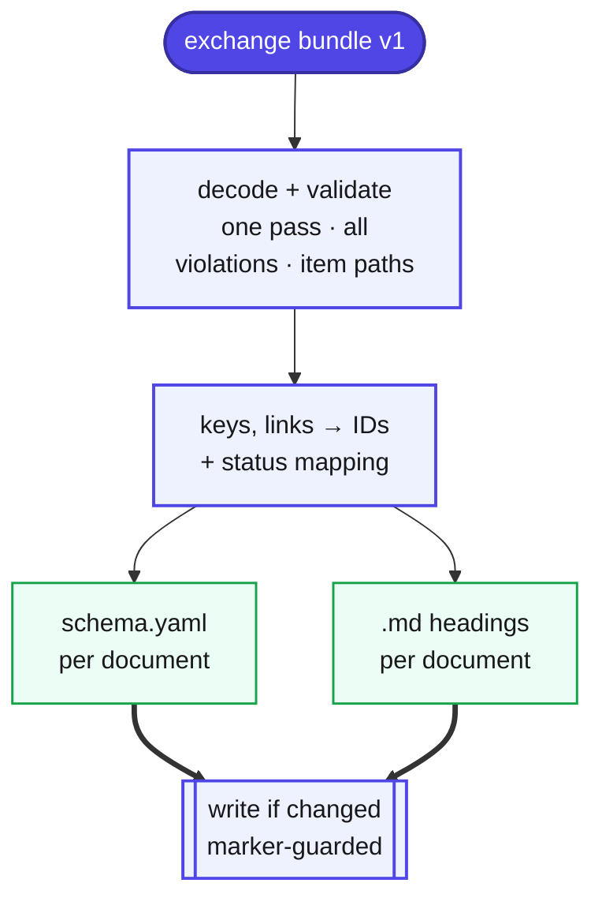

`reqmd-import` is the **only** writer of reqmd documents from imported data. A
producer emits one JSON bundle in the [exchange format](/exchange/v1/), and
this tool renders it into `schema.yaml` plus Markdown — idempotently, with the
generated marker that makes re-runs safe. It does not care whether the bundle
came from [reqmd-code](/import/reqmd-code/), a DOORS extract, a database
query, or a spreadsheet converter.

```sh
go build -o reqmd-import ./reqmd-import/cmd/reqmd-import

reqmd-import bundle.json -o spec/00-doors/          # render
reqmd-import bundle.json --validate-only            # report violations, write nothing
reqmd-import bundle.json -o spec/00-doors/ --check  # render, then run `reqmd check` on the output
reqmd-code ./src | reqmd-import - -o spec/03-software/imported
```

Why one renderer: a second Markdown writer in Python (or Java, or DXL) would
drift from the quoting, heading, and schema rules. The JSON format is the
stable contract; the renderer is the only code that knows the file syntax.
Writes are guarded by `<!-- reqmd: generated -->`: hand-authored files are never
overwritten, and unchanged output is not rewritten.

## Bundle rules

Any tool that can print JSON can feed reqmd. A minimal bundle — one section
grouping two requirements:

```json
{
  "$schema": "https://reqmd.dev/exchange/v1/schema.json",
  "documents": [
    {
      "key": "brakes",
      "title": "Brakes Module",
      "properties": {"priority": {"type": "string", "enum": ["High", "Low"]}},
      "x-reqmd": {"id-prefix": "DOORS-", "level": "stakeholder-requirements",
                  "external": true, "dir": "brakes"},
      "items": [
        {"kind": "section", "title": "Hydraulics",
         "children": [
           {"kind": "requirement", "key": "17", "title": "Brake request",
            "body": "The pedal shall request braking.", "fields": {"priority": "High"}},
           {"kind": "requirement", "key": "42", "title": "Brake pressure",
            "fields": {"priority": "Low"}, "links": ["17"], "refs": ["SYS-BRAKE-001"]}
         ]}
      ]
    }
  ]
}
```

The format deliberately keeps the *source tool's* stable IDs:

- `kind` is `requirement` (content: a reqmd block, validated, traced, counted)
  or `section` (structure only: a heading, its prose, its children). A section
  with children renders as a folder; one without renders as a prose block.
- `key` is the DOORS object number or codeBeamer item ID, unique per document.
  The reqmd ID becomes `<x-reqmd.id-prefix><key>` (`DOORS-17`), so re-imports
  never churn IDs and hand-written `trace:` links keep resolving.
- `children` nest items in document order. There is no parent pointer to get
  wrong: a missing parent, an out-of-order child and a cycle are unrepresentable.
- `links` name other items by key (`"17"`, or `"brakes/17"` across documents)
  and are rewritten to full requirement IDs; `refs` hold IDs owned elsewhere and
  are passed through verbatim. `reqmd-code` uses `links` for resolved
  `reqmd:trace <symbol>` targets and convention test links, and `refs` for
  requirement IDs written in source comments.
- `fields` are the reqmd-block entries (sections never carry them). A JSON
  string stays a string even when it reads like a number, `null` or `true`, so
  send a real number or boolean when you mean one.
- `body` is Markdown and **must not contain headings** — structure belongs in
  sections. Doc comments with headings are split into sections by `reqmd-code`
  for exactly this reason.
- `status` is your own vocabulary. `--status-map "In Review=review"` translates
  it; an unmapped value falls back to reqmd's default and is kept as
  `x-reqmd.source-status`.
- `properties` / `required` describe the reqmd block's JSON Schema, which the
  renderer writes into the document's `schema.yaml`.
- `x-reqmd.external: true` marks the document a proxy for content authored
  elsewhere.

The renderer never normalizes, reorders or drops: anything that would corrupt a
document — a dangling link, a section with fields, an undeclared attribute, a
line break in a title, a nesting deeper than six heading levels — is rejected,
and every violation is reported in one run with an item path.

## Writing your own producer

The `python/` directory ships `reqmd_io`, typed dataclasses that emit the same
JSON (no Markdown or YAML logic), plus a generic DOORS/codeBeamer CSV reader in
`python/examples/csv_import.py`. Quickstart [step 15](/quickstart/15-custom-importers/)
walks through building a producer end to end; [exchange format v1](/exchange/v1/)
is the full field reference.

Full field reference, every rule and two complete examples:
[exchange format v1](/exchange/v1/) · machine-readable
[`schema.json`](/exchange/v1/schema.json) · source
[`reqmd-import`](https://github.com/dVoo/reqmd/tree/main/reqmd-import) and
[`python/`](https://github.com/dVoo/reqmd/tree/main/python).

## What it doesn't do

- **Sync back to the ALM.** The spec tree is the review surface; the ALM stays
  the system of record for its own items.
- **Generate requirement content.** It renders what the bundle says; coverage-
  or trace-guessing is a producer decision.
- **Write hand-authored documents.** Files without the generated marker are
  left untouched.

## Architecture



Validation happens before any file is written, and re-running unchanged input
produces byte-identical output. That is what makes the import safe to run in CI
on every PR.

## See also

- [reqmd-code](/import/reqmd-code/) — the built-in source extractor.
- [Code & import](/import/) — the pipeline overview.
- [Exchange format v1](/exchange/v1/) — the contract.
- [Quickstart 15](/quickstart/15-custom-importers/) — a custom importer.
