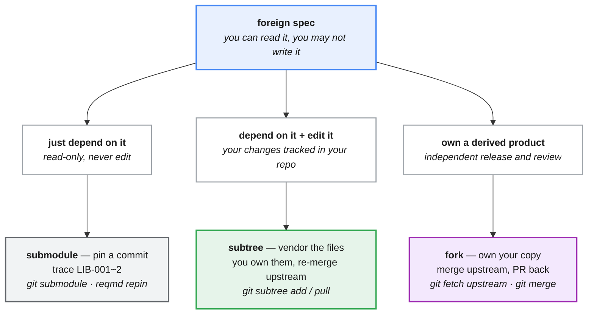

reqmd lives on top of git. Four git primitives — **branches, forks, submodules, subtrees** — plus one reqmd-native primitive, **variant attributes**, cover the ways a specification splits, assembles, and is reused. This page is *use-case first*: find what you're trying to do, and it hands you the mechanism and the everyday commands.

## At a glance

| You want to… | Use | Every day |
|---|---|---|
| Evolve a spec, then reconcile | **Branch** | `git switch -c feat/…` · `reqmd baseline diff main <branch>` · merge |
| Ship several configurations from one spec | **Variant attribute** | `reqmd check --filter '…'` · `--disjoint-check variant` · CI matrix |
| Depend on a foreign spec, read-only | **Submodule** (pin) | bump the pin · `reqmd repin` · `reqmd check` |
| Depend on a foreign spec *and* edit it locally | **Subtree** (vendor) | `git subtree pull` · edit · `reqmd check` |
| Own a derived product, independent of the original | **Fork** | `git fetch upstream` · `git merge upstream/main` |
| Assemble several teams' specs into one tree | **Submodules** (or **subtrees**) | `git submodule update` · `reqmd check` |

## Divergence: how one spec splits

Two questions pick the mechanism: *same or separate repo?* and *temporary or permanent?*

<div class="divergence-matrix">
  <div class="dm-head"></div>
  <div class="dm-head">same repo</div>
  <div class="dm-head">separate repo</div>

  <div class="dm-axis">permanent</div>
  <div class="dm-card dm-variant"><span class="dm-title">Variant attribute</span><span class="dm-sub">coexist in one tree</span></div>
  <div class="dm-card dm-fork"><span class="dm-title">Fork</span><span class="dm-sub">permanent, independent</span></div>

  <div class="dm-axis">temporary</div>
  <div class="dm-card dm-branch"><span class="dm-title">Branch</span><span class="dm-sub">merge or die</span></div>
  <div class="dm-card dm-dead"><span class="dm-title">Wrong tool</span><span class="dm-sub">a branch that never merges</span></div>
</div>

- **Branch** (same repo, temporary) — change-in-progress that reconciles: it merges back or is discarded. See [Branches](#branches).
- **Variant attribute** (same repo, permanent) — coexisting configurations that ship together from one commit and share one `reqmd check`. See [Variant attributes](#variant-attributes).
- **Fork** (separate repo, permanent) — a permanently independent repo with its own release cadence and review. See [Forks](#forks).
- **Wrong tool** (separate repo, temporary) — the empty cell. A branch that never merges and never dies is a fork or a variant, not a branch.

The decision flow, as questions:

```
Will the two things reconcile (merge or die)?
  yes → branch
  no → Do they release and review independently
       (separate cadence, no shared check)?
    yes → fork (separate repo)
    no  → variant attribute (one tree, one check, one review)
```

**Primary discriminator — the independence test.** If the two things release and review independently (separate cadence, no shared `check`), they're a fork. If they must ship together from one commit and share one review, they're variants. **The validation test** is the reqmd-native corollary: variants must pass `check` against each other in one tree ("A adds over B" must be answerable from one commit); forks are validated separately.

Submodules and subtrees aren't on this grid — they're the orthogonal *ownership/assembly* layer, covered under [Reuse](#reuse-using-someone-elses-spec) and [Submodules and subtrees](#submodules-and-subtrees).

## Reuse: using someone else's spec

The first question is **intent**: do you just want to depend on it, do you need to change it, or do you want to own a fork? Each path has a different everyday flow.



Read left to right:

- **Just depend on it** → **submodule at a pin.** The foreign repo stays separate; your top-level repo records a commit SHA. Your requirements `trace:` up to it with version pins (`LIB-001~2`); `reqmd repin` updates the pins when you bump. No merge, ever — you never edit upstream. See [Submodules](#submodules).
- **Depend on it *and* edit it** → **subtree vendor.** The foreign files are copied into your tree and history, so your changes are ordinary commits in your repo (no write access to upstream needed). `git subtree pull` re-merges upstream with a real three-way merge. See [Subtrees](#subtrees).
- **Own a derived product** → **fork.** A permanently independent repo you own; you pull upstream changes with `git merge` and can contribute back by PR. See [Forks](#forks).

## Branches

**Use when** a change is in progress and will reconcile — merge or die. `reqmd baseline diff` compares two points in time of one tree, which is exactly a branch's life: before-merge vs after-merge, or release-tag vs release-tag.

**Every day:**

```sh
git switch -c feat/login-2fa
# edit requirements
reqmd check .                              # validate as you go
reqmd baseline diff main feat/login-2fa    # review the change before merging
git switch main && git merge feat/login-2fa
```

**Don't use it when** the difference is permanent:

- **Long-lived branches for variants** never merge and lose single-tree validation and review — use a `variant` attribute instead ([Variant attributes](#variant-attributes)).
- **Long-lived branches that are really a separate product** bit-rot and can't release independently — that's a fork ([Forks](#forks)).

The one-line rule: **if your branch will never merge and never die, it isn't a branch.**

## Variant attributes

**Use when** coexisting configurations ship together from one commit: Base/Premium/Sport, platforms, regions, owners. You declare a `variant` array attribute in `schema.yaml` like any other custom attribute, tag each requirement, and scope every command with `--filter "<expr>"`. One tree serves any number of configurations with no extra files, branches, or vocabulary.

**Every day:**

```sh
# one configuration's view (Sport-specific + common-to-all)
reqmd check . --filter '"Sport" in variant or variant == nil'
# catch a trace link between incompatible configurations
reqmd check . --disjoint-check variant
# the "what Premium adds over Base" evidence, from a single commit
reqmd baseline diff --filter-a 'variant == nil or "Base" in variant' \
  --filter-b '"Premium" in variant' HEAD
```

In CI, run one `reqmd check --filter "${{ matrix.filter }}" --json` per configuration, plus a `--disjoint-check variant` job. Declare `x-reqmd.disjoint-check: variant` in `schema.yaml` to enforce it on every check.

A requirement with no `variant` attribute is "common to all" — the bare filter `"X" in variant` matches only requirements explicitly tagged X; add `or variant == nil` for the full configuration view.

See [Step 14 — Variant management](/quickstart/14-variant-management/) for a complete worked example.

## Forks

**Use when** you own a permanently independent product derived from another repo: separate release cadence, separate review, never validated against the original in one `check`. It never reconciles.

Two sub-types, same axis:

- **Host fork** (GitHub/GitLab "Fork" button) — the host records the parent link and gives a sync UI plus contribute-back-via-PR. Updates: "Sync fork" / `gh repo sync`.
- **Raw-git fork** (`git clone` + `git remote add upstream`) — manual relationship, works on any git host. Updates: `git fetch upstream && git merge`.

**Every day:**

```sh
git fetch upstream
git merge upstream/main                    # 3-way merge of upstream changes
reqmd baseline diff <upstream-tag> HEAD    # see how far you've diverged
```

**Fork vs depend at a pin vs vendor** — the discriminating question is whether you *modify* the foreign requirements:

| | Fork | Submodule (pin) | Subtree (vendor) |
|---|---|---|---|
| You own the requirements | yes | no | yes (the files) |
| Update from upstream means | merge upstream commits | bump the pin + `reqmd repin` | `git subtree pull` (3-way merge) |
| Conflicts on your edits | yes (merge tax) | no (you don't edit) | yes (re-merge) |
| reqmd mechanism | `baseline diff <upstream> HEAD` | `~N` pins + `repin` | vendored files diff as content |

**Fork** if you own and evolve a copy. **Submodule** if you consume at a pinned commit and don't modify it. **Subtree** if you modify it but want the changes tracked in your own repo without hosting a fork — see [Subtrees](#subtrees).

See the [submodule FAQ entry](/faq/#how-it-works) and [Step 10 — Submodule-friendly configuration](/quickstart/10-submodule-configuration/) for the document-id tracing pattern.

## Submodules and subtrees

Two ways to assemble an owned tree from other repos, orthogonal to the divergence axes. Each team owns their own requirements repo; a top-level repo assembles them into one tree that `reqmd check` validates as a whole. The difference is *where the content lives*: a submodule keeps it in a separate repo behind a pinned reference; a subtree vendors it into your own tree and history.

### Submodules

**Use when** each team keeps its own repo and you assemble the pins — you depend on the submodules' live history without vendoring their content. This is **not a monorepo**: the content stays in the team repos; the top repo stores only a pin (gitlink) per directory. What's "mono" is the *checked-out* tree — after `git submodule update` the working tree looks like one repo, and `reqmd check` validates it as one.

A typical layout:

```
spec-assembly/
  stakeholder/        ← submodule: git@github.com:team/stakeholder-spec.git
  system/             ← submodule: git@github.com:team/system-spec.git
  software/           ← submodule: git@github.com:team/software-spec.git
  tests/              ← submodule: git@github.com:team/test-spec.git
```

**Every day:**

```sh
git clone --recurse-submodules <top-repo>
reqmd check .                       # the assembled tree validates as a whole
# when a team releases a new spec version:
git -C library fetch && git -C library checkout v1.3
reqmd repin .                       # update LIB-001~2 → ~3 (dry-run; --yes to apply)
reqmd check .
git commit -am "bump library to v1.3"
```

The baseline *is* the submodule pins: `reqmd baseline diff v1.0 v2.0` reads the pins at each tag and reports what changed across all submodules, plus which pins were updated. Submodules compose with all three divergence axes — a branch lives inside a team's submodule, variant attributes live inside its requirements, and a fork can be assembled as a submodule or kept as a separate repo.

### Subtrees

**Use when** you reuse a foreign spec but need to change it, and your changes must be tracked in *your* repo (no write access to upstream). `git subtree` vendors the files into your tree and history — a plain `git clone` gets everything, no `--recurse-submodules`, no `.gitmodules`, no live pointer.

**Every day:**

```sh
git subtree add --prefix=library https://github.com/org/spec-library.git main   # vendor it in
git subtree pull --prefix=library https://github.com/org/spec-library.git main  # 3-way merge upstream
git subtree push --prefix=library https://github.com/org/spec-library.git main  # contribute back
# edit library/ requirements as your own
reqmd check .
```

Because the upstream history is preserved (don't use `--squash`), `git subtree pull` performs a real three-way merge: your local edits survive upstream restructuring, instead of conflicting like a raw diff would. A vendored subtree is just another reqmd document directory with its own `schema.yaml`, so `trace:` refs resolve normally. The one difference from a submodule: `reqmd baseline diff` reports *submodule pin* changes, but a subtree has no gitlink — its changes surface as ordinary content diffs.

| | Submodule | Subtree |
|---|---|---|
| Content lives | separate repo, parent pins a SHA | copied into your tree + history |
| `git clone` | needs `--recurse-submodules` | plain clone, fully self-contained |
| Sync upstream | bump the pin + `reqmd repin` | `git subtree pull` (3-way merge) |
| Edit upstream content locally | not intended | yes — edits live in your history |
| reqmd diff surface | `baseline diff` reports pin changes | vendored files diff as normal content |

## How they compose

Branches, variants, and forks are orthogonal axes that compose; submodules and subtrees add the ownership/assembly layer on top:

- **Branches** are the temporal axis: you branch to develop, merge into a tree.
- **Variants** live *inside* the merged tree as attributes for coexisting configs.
- **Forks** are separate repos; each fork has its own branches and its own variants.
- **Submodules and subtrees** assemble owned/foreign repos into one validated tree.

A mature setup: team-owned spec repos assembled at a top-level repo (submodules for ownership, subtrees for vendored foreign specs), each carrying `variant` attributes for coexisting configs, all evolving through short-lived feature branches, with genuinely independent products split off as forks.
