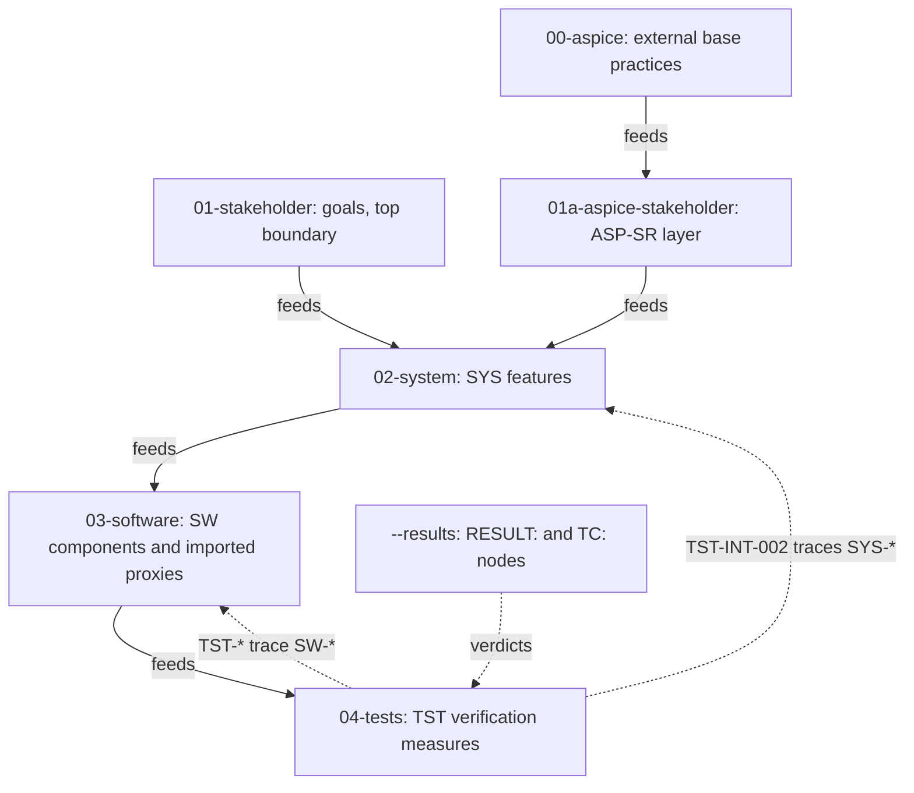

# reqmd Test Specifications

## Build and quality gates

The gate every change has to pass before anything else is asserted.

### TST-FIX-001: Build and test gate
```attr
status: approved
verify: Test
test-type: build
disposition: implemented
trace:
  - SW-CLI-001
```
The project shall build cleanly with `go build ./... ./reqmd-code/... ./reqmd-import/...` and all tests shall pass with `go test ./... ./reqmd-code/... ./reqmd-import/...` after every change.

*Rationale:* A build-and-test gate in CI prevents regressions. Existing tests must be maintained and extended as features are added; the workspace module boundary means `./...` alone does not cover the nested modules.

## Unit tests

Tests pinned at one package or one format contract, where a failure names the broken rule.

### TST-UNT-001: Core package unit tests
```attr
status: approved
verify: Test
test-type: unit
disposition: implemented
trace:
  - SW-PAR-001
  - SW-SCH-001
  - SW-GRA-001
  - SW-CHK-001
```
Unit tests shall cover the parser, schema, and graph packages with inline fixtures (no external files): attr scanning and scalar typing, every graph check condition (broken, duplicate, ambiguous, circular, id-prefix, disposition, coverage, suppression), schema compilation paths (built-in injection, reserved-name rejection, `additional-status-values` validation), and the parent-child edge pass including broken-parent errors.

*Rationale:* Inline fixtures keep tests self-contained and fast. These packages constitute the core validation pipeline and require the highest confidence; each check has distinct branches exercised independently.

### TST-UNT-002: Frontmatter, rendering, and client interaction tests
```attr
status: approved
verify: Test
test-type: unit
disposition: implemented
trace:
  - SW-PAR-001
  - SW-EXP-001
```
Unit tests SHALL verify frontmatter extraction into `Document.Meta` on both the serial and the chunked path, first-file-wins merging across files, and that the block never reaches a node body, goldmark body rendering for inline code, emoji, alerts, and fenced blocks, search-and-filter client logic (debounce, AND-combined filters, card hide/show, count update, child card visibility), and the server-rendered outline: correct parent/child nesting, expand/collapse, and scroll-spy targets.

*Rationale:* These features have distinct logic paths requiring dedicated coverage. Frontmatter touches the parser AST pipeline; the outline and filter are client-side behaviours verified through rendered HTML.

### TST-UNT-003: Content-tree and item tests
```attr
status: approved
verify: Test
test-type: unit
disposition: implemented
trace:
  - SW-PAR-002
  - SW-EXP-002
```
Unit tests shall cover the content tree: preamble prose captured as a headingless section node, requirement-less files fully preserved, a heading without an `attr` block remaining `KindSection` whether or not it has children, mid-file headings becoming nodes instead of body text, `ParentID` pointing at the nearest ancestor requirement (never a section), thematic breaks kept in bodies, a level-1 heading with an attr block rejected as a parse error, a second level-1 heading rejected as a parse error, deterministic multi-file merge order, and the chunked parallel path retaining the file preamble. Tests shall also cover item-aware output: `ls`/`stats` Type columns and counts, CSV rows in document order for all node kinds, HTML folder sections and leaf-section blocks, `pageModel` entries carrying `type`/`parentId`/`children`, and `--filter` applying the section prune rule (folders whose children were all pruned are dropped, leaf sections with prose survive, bare headings are dropped).

*Rationale:* The content tree is the parser's core contract — content must never be dropped and nesting must stay faithful to the source. Item-aware output crosses the parser, reporter, and exporter packages, so it needs dedicated end-to-end coverage.

### TST-EXP-001: NDJSON table export tests
```attr
status: approved
verify: Test
test-type: unit
disposition: implemented
trace:
  - SW-EXP-003
```
Unit tests shall cover the four NDJSON tables: the requirements table containing requirement rows only (no section rows, no `type` column) with `section_path` built from ancestor section titles, `ordinal` in document order and unchanged under `--filter`, built-in promotion to top-level columns (`version` as a string), the `attrs` envelope for remaining attributes, the full fixed column set present on every row (empty strings, with collections, `pin` and `version` null when unset), trace rows carrying ref/target/pin/resolution state with the target free of any `document/` qualifier, results rows including evidence cases with the results table written but empty when no results are loaded, findings rows carrying level/code/direction, and byte-identical output across repeated exports of the same tree.

*Rationale:* Warehouse consumers depend on a stable column set and on deterministic output; both are properties of the writer alone, so they are pinned at the writer level rather than through a warehouse round-trip.

### TST-INI-001: Scaffolding preset tests
```attr
status: approved
verify: Test
test-type: unit
disposition: implemented
trace:
  - SW-INI-001
```
Unit tests shall cover `init`: the generic preset rendering schema and example with the requested id-prefix and title, the results preset defaulting to `verify-results` level and `VR` prefix, a custom preset directory rendering both Go templates with `.ID`, `.Title`, `.Level`, and `.IDPrefix`, and the run aborting on an existing document unless `--force` is given.

*Rationale:* The scaffold is the first thing a new user runs and the templates are user-facing text, so a broken template or a wrong default is immediately visible; the custom-preset path shares the same renderer and must be exercised alongside the built-ins.

### TST-REP-001: Version-pin repin tests
```attr
status: approved
verify: Test
test-type: unit
disposition: implemented
trace:
  - SW-REPIN-001
```
Unit tests shall cover version-pin delta computation and application: outdated refs proposed and rewritten in place, predated refs reported but never rewritten, `--promote-unpinned` adding unpinned refs only against a versioned upstream, whole-ref matching so a promote cannot rewrite the bare ID inside an already-pinned sibling, JSON delta shape and counts, and rewrite scope limited to ` ```attr ` blocks so surrounding prose is preserved byte-for-byte.

*Rationale:* `repin` writes to source files, so a matching bug silently corrupts spec content. The whole-ref and attr-block-scope guarantees are the safety properties that must be regression-tested.

### TST-FIL-001: Filter package tests
```attr
status: approved
verify: Test
test-type: unit
disposition: implemented
trace:
  - SW-FIL-001
```
Unit tests shall cover the `internal/filter` package: expression compilation (including rejection of undeclared attributes), matching against requirement attribute maps plus `id`/`title`, per-document nil handling, `FilterDocs`/`MatchingIDs`, filter-aware coverage (a filtered-out inbound cannot satisfy a filtered-in requirement), and the `--relaxed-filter` path (`BuildFoundAttrs`, `CompileRelaxed` warnings).

*Rationale:* The filter engine is the gate for scoping `check`, exports, and diffs. Compile-time typo rejection and filter-aware coverage semantics are load-bearing and must be pinned by tests.

### TST-DIS-001: Disjoint-attribute check tests
```attr
status: approved
verify: Test
test-type: unit
disposition: implemented
trace:
  - SW-DIS-001
  - SW-SUP-001
```
Unit tests shall cover the `disjoint-attribute` graph check: zero intersection produces an ERROR, overlapping values pass, empty/absent attribute is exempt, enablement via `--disjoint-check` and `x-reqmd.disjoint-check`, and suppression via `reqmd-suppress`.

*Rationale:* The check gates cross-cutting attribute consistency (variants, safety levels) that other trace checks do not; both the intersection logic and the exemption/suppression paths need coverage.

### TST-STS-001: Status lifecycle tests
```attr
status: approved
verify: Test
test-type: unit
disposition: implemented
trace:
  - SW-STS-001
```
Unit tests shall cover the status lifecycle: missing status defaults to approved, draft requirements do not satisfy coverage, `x-reqmd.additional-status-values` validation (lowercase-only, reserved collision, duplicates), `x-reqmd.ignore-status` making all requirements coverage providers, and the draft-downstreams-ignored coverage message.

*Rationale:* The lifecycle is enforced across schema, graph, and exporter; the coverage-provider gate changes validation outcomes and must be regression-tested.

### TST-LEV-001: Level-typed coverage tests
```attr
status: approved
verify: Test
test-type: unit
disposition: implemented
trace:
  - SW-LEV-001
```
Unit tests shall cover level-typed `requires-trace-from`: a level token expands to every document declaring it, coverage is satisfied by any approved inbound from those documents, document-id tokens still resolve, and unknown tokens produce a WARNING.

Unit tests shall also cover the `x-reqmd.requires-trace-from` document default (SYS-FMT-003): a requirement that does not declare the attribute inherits the document default and is checked against it; a requirement that declares its own attribute overrides the default; `requires-trace-from: []` opts a requirement out even under a non-empty default; an empty document default opts every requirement in the document out; and a document without a default leaves its requirements on the generic boundary-inference fallback.

*Rationale:* Level resolution changes coverage semantics for multi-document layers; the expansion, inheritance, and fallback paths must be verified independently.

### TST-VER-001: Verify package tests
```attr
status: approved
verify: Test
test-type: unit
disposition: implemented
trace:
  - SW-VER-001
  - SW-VER-002
  - SW-VER-003
```
Unit tests shall cover the `internal/verify` package: CTRF JSON parsing (status→outcome mapping, flaky→inconclusive, uninstrumented tests skipped silently, `~N` pin preservation, malformed JSON and non-CTRF shape handling), multi-file latest-wins merge by timestamp, manual-results loading via `parser.Discover`, non-CTRF JSON skip, and pseudo-requirement synthesis (ID, trace with pin, outcome attr, synthetic document flag).

*Rationale:* The verify package is the entry point for the V&V results feature. Each parsing path (CTRF, manual, auto-detection) has distinct logic that must be exercised independently; the merge semantics (latest-wins, pin stripping) are load-bearing for correctness.

### TST-VER-002: Outcome-gated graph checks tests
```attr
status: approved
verify: Test
test-type: unit
disposition: implemented
trace:
  - SW-VER-004
```
Unit tests shall cover the `missing-verdict` and `failing-verdict` graph checks: no-op when no result nodes are present, missing-verdict fires for approved measures without results, missing-verdict skips draft measures, failing-verdict fires for a fail outcome at ERROR, failing-verdict does not fire for pass, and version-pin fires on stale result pins.

Unit tests shall also cover case-keyed binding and evidence roll-up: `extra.x-reqmd.case`/`verifies`/`description` parsing and silent skip of uninstrumented tests, latest-wins per (measure, case) by `stop`, synthesized `TC:<case>` nodes with `trace` edges and description bodies, cased `RESULT:` identities, roll-up over authored and synthesized downstream test cases (mixed evidence with one failing case fails the requirement), draft downstream cases reported as ignored by missing-verdict, filter-aware evidence, deferred/rejected measure exemption, `unbound-result` warnings and their `--ignore-unbound-results` suppression, and the INFO `verdict` line plus the JSON/text results section.

*Rationale:* The outcome-gated checks are the core of the V-model right-side closure. Each check has status-gated and outcome-gated branches that must be independently verified to prevent false positives and false negatives. Case-keyed binding and roll-up change the merge, synthesis, and check semantics together, so they need dedicated coverage.

### TST-IMP-001: reqmd-code extraction tests
```attr
status: approved
verify: Test
test-type: unit
disposition: implemented
trace:
  - SW-IMP-001
  - SW-IMP-002
  - SW-IMP-003
```
Unit tests shall cover the `reqmd-code` pipeline: language plugin parse/classification for C, C++, Go, Python, and Rust (kinds, method receivers, doc binding, top-level-only scope rules), trace extraction (explicit `reqmd:trace` markers and opt-in heuristic IDs), and the emitted exchange bundle (per-package documents with distinct id-prefixes, one file section per source file, key-identified requirements, methods nested under their type, doc comments rendered as child sections rather than requirement bodies, provenance attrs, deterministic output across runs, and duplicate-symbol dedup). The bundle shall be decoded and rendered back through the shared exchange package so the producer/renderer contract is exercised end to end.

*Rationale:* reqmd-code closes the code side of the V-model; each language plugin has a distinct tree-sitter query and mapping that must be pinned, and the bundle's determinism is what makes re-running the extractor a safe no-op in CI.

### TST-IMP-002: Exchange format and renderer tests
```attr
status: approved
verify: Test
test-type: unit
disposition: implemented
trace:
  - SW-IMP-004
  - SW-IMP-005
  - SW-IMP-006
  - SW-IMP-008
```
Tests shall enforce the format's invariants rather than any particular rendering. Every rejection rule stated in the exchange format document shall have a test that fails when the rule is removed, and every rejection shall be reported through one batched error naming the item path. Every valid bundle in the shared fixture corpus shall render without error and shall also satisfy the published JSON Schema, so the schema and the renderer cannot diverge. Rendering shall be asserted structurally — the heading outline (level, heading text, parsed attr block) and the item tree — never as matched substrings of generated Markdown, so formatting changes do not break a test that is about structure. Idempotency, quoting round-trip through a YAML parser, and the guarantee that hand-authored files are never rewritten shall be pinned.

*Rationale:* The renderer is the correctness boundary for every importer, including the ones not written in this repository. Pinning the rules instead of their wording means a new rule adds a test without rewriting the specification, and asserting structure instead of text means a formatting change cannot mask a nesting bug.

### TST-IMP-003: Python exchange helper tests
```attr
status: approved
verify: Test
test-type: unit
disposition: implemented
trace:
  - SW-IMP-007
```
Tests shall pin the Python helper's contract with the format rather than its internals: a generated bundle shall satisfy the published JSON Schema when a JSON-Schema implementation is available (the neutrality proof — a producer can be written without any Go code), section and requirement items shall be distinguishable by kind alone, nesting shall be reachable through a parent key so a flat source table stays a flat loop, and empty values shall be omitted so the wire form matches the Go producer's.

*Rationale:* The helper mirrors a versioned contract; a drift would surface as a rejected bundle downstream rather than at the producer, so the mapping is pinned by test — but pinned against the published schema, which is the artefact a third party actually implements.

## Integration and browser tests

Tests that cross package and module boundaries, or drive the produced artefacts.

### TST-INT-001: End-to-end integration tests
```attr
status: approved
verify: Test
test-type: integration
disposition: implemented
trace:
  - SW-EXP-001
  - SW-LEV-001
  - SW-VER-004
```
Integration tests shall run the full pipeline end-to-end: parse a multi-level requirement tree (including sub-requirements and items), validate all attributes, build the graph (including the parent-child pass), run the complete graph check catalog, and produce correct CSV/HTML output with hierarchical display. The repository's own `spec/` tree shall be the primary fixture: it must validate with zero invalid requirements and must exercise level-typed coverage, document-level coverage defaults, verification results, and imported proxy documents.

That fixture shall be read as a V-model rather than as a pile of directories: every level declares its upstream level in `x-reqmd.upstream` (`00-aspice` and `01-stakeholder` are boundaries, and `02-system` draws on both `01-stakeholder` and `01a-aspice-stakeholder`), work descends to `04-tests`, and the test specifications at the bottom carry verification back up: `TST-*` requirements trace to the `SW-*` requirements above them (and the integration test traces to `SYS-*`), while `--results` binds `RESULT:` and `TC:` verdicts to the `TST-*` measures.



*Rationale:* Integration tests catch cross-package contract violations that unit tests miss. Using the project's own specification as the fixture keeps that specification executable and current.

### TST-INT-002: Import pipeline end-to-end
```attr
status: approved
verify: Test
test-type: integration
disposition: implemented
trace:
  - SYS-IMP-002
  - SYS-IMP-003
  - SYS-CON-001
  - SYS-CON-002
```
An end-to-end test shall exercise the pipeline across module boundaries, because every stage is otherwise tested only against hand-built fixtures. It shall take a real exchange bundle, render it, discover the rendered tree, validate it, and export it, then assert the outcome structurally: a section in the bundle is a section node in the parsed tree, the requirements beneath it are identified and validate with zero invalid, the requirements table carries requirement rows only with `section_path` naming their ancestor section and `ordinal` in document order, internal links and external refs both arrive as trace references, and CSV keeps the section row. A second integration test shall parse a real document with nested sections, prose and a leaf section, then assert both the unfiltered export and a filtered export: a folder that still leads to a matching requirement keeps its place, a folder whose requirements were all pruned is dropped, and a leaf section carrying prose survives. When a Python interpreter is available the documented CSV producer flow shall be exercised as well — CSV to bundle to rendered tree to a clean validation — and skipped with an explicit reason when it is not.

*Rationale:* The pieces are individually tested but the seams are not, and the defects found while writing these tests were seam defects — a phantom content node in every generated file, and a wrong expectation about what filtering keeps — which unit tests with hand-built fixtures cannot see.

### TST-HTM-001: HTML export, project home, and browser tests
```attr
status: approved
verify: Test
test-type: integration
disposition: implemented
trace:
  - SW-EXP-001
  - SW-SEC-001
  - SW-EXP-004
```
Tests shall cover the HTML export: server-rendered Document view with requirement cards, nested child cards, container sections and info blocks; attribute grid including undeclared attributes and array/nested values; coverage, verdict, and link-state chips including `no verdict` as a first-class outcome; escaped requirement text, attribute values, and embedded `pageModel` JSON; the project home page (catalog, health, actionable queues); and the analytical views. Tests shall also cover diagram rendering: a `mermaid` fence surviving the parser with its delimiters, the page emitting a `mermaid` container plus the pinned runtime script when it contains a diagram, and a page without one making no external request at all. A browser-driven smoke suite shall verify deep links, URL filter round-tripping (including explicitly empty filters), outline selection and resizing, palette navigation, matrix bounds, mobile outline behaviour, section folders folding their contents, a filtered-out parent keeping its visible children, popover dismissal, and expanded table rows opening their detail block.

*Rationale:* The HTML export is the primary review surface, and most of its behaviour only exists after the embedded client script runs. Splitting DOM-level assertions from browser assertions keeps the fast suite meaningful while still pinning the interactive contract.

### TST-CLI-001: Command wiring and exit codes
```attr
status: approved
verify: Test
test-type: integration
disposition: implemented
trace:
  - SW-CLI-001
  - SW-SAF-001
```
Tests shall cover command wiring through cobra: `check`, `ls`, `stats`, `export csv|html|json`, `serve`, and `baseline diff` flag parsing; filter compile errors surfacing as command failures; `--relaxed-filter` warnings; `--disjoint-check` from both flag and schema; `--ignore-unbound-results`; `--relaxed-versions` demoting outdated pins while leaving predated pins fatal; and exit codes 0/1/2 for valid, invalid, and unparsable trees.

*Rationale:* Flag wiring is the glue between the CLI surface and the packages; a dropped flag silently disables a check in CI, which no package-level test would catch.

### TST-SRV-001: Serve with results integration tests
```attr
status: approved
verify: Test
test-type: integration
disposition: implemented
trace:
  - SW-SRV-001
  - SW-VER-003
  - SW-VER-004
```
Integration tests shall verify that `serve --results <path>` loads verification results, renders verdict badges in the HTML output, watches result file paths for changes (both fsnotify and polling fallback), and triggers a rebuild when result files change. Tests shall confirm that CTRF JSON changes update verdict badges from pass to fail and that the `failing-verdict` check fires on rebuild.

*Rationale:* The `serve --results` feature combines the live-reload watcher with the verify pipeline. Both the fsnotify and polling watcher paths must be exercised to ensure result-file changes trigger rebuilds in both modes, and the verdict badge must be verified in the rendered HTML, not only in the graph checks.
